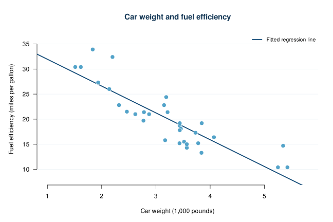

# Car Weight and Fuel Efficiency

This project looks at whether heavier cars tend to get lower gas mileage. It uses R to make a scatterplot and fit a simple linear regression.



## About the data

The data comes from `mtcars`, a dataset that is already included in R. It has information about **32 car models from 1973–1974**.

The two variables used here are:

- **`wt`**: car weight, in thousands of pounds
- **`mpg`**: miles per US gallon

Source: [R documentation for the mtcars dataset](https://stat.ethz.ch/R-manual/R-devel/library/datasets/html/mtcars.html).

## What the project does

1. Takes a look at the data and makes a scatterplot.
2. Fits a simple linear regression using `lm(mpg ~ wt)`.
3. Uses the results to describe the relationship between weight and mpg.

## Results

The fitted regression line is:

**Predicted mpg = 37.29 − 5.34 × weight**

The line slopes downward, which means heavier cars in this dataset tended to get fewer miles per gallon. According to the model, a 1,000-pound increase in weight is associated with about **5.34 fewer miles per gallon**.

The **R² is about 0.753**, so the linear model using weight explains about 75.3% of the variation in mpg for these 32 cars. This does not mean that every prediction is 75.3% accurate.

## Limitations

This is a small dataset, and the cars are from the 1970s, so the results may not apply to newer cars. Other factors, like engine size, could also affect gas mileage. This analysis shows a relationship, but it does not prove that weight alone caused the difference.

## How to run it

No extra packages are needed. In RStudio, open `analysis.R`, choose **Session → Set Working Directory → To Source File Location**, and click **Source**. You can also run this from the project folder:

```r
source("analysis.R")
```

The code prints the regression results and saves the plot in the `figures` folder.

## Files

- `analysis.R` — the R code
- `figures/weight_vs_mpg.svg` — the scatterplot and fitted line
